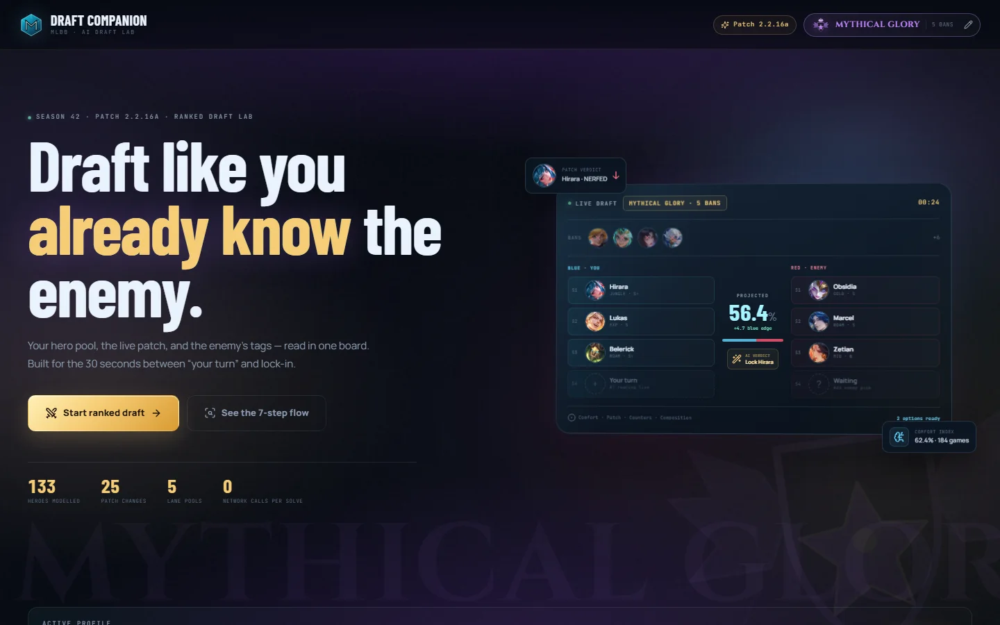

# MLBB Draft Companion AI

**Draft like you already know the enemy.**

A fast, local-first draft assistant for Mobile Legends: Bang Bang. It combines a permanent three-core-hero lane profile with optional slots up to eight, current patch verdicts, hero matchup data, team-composition scoring, partial-board projections, and opponent-tailored game plans in one responsive screen.

Built for the 30 seconds between "your turn" and lock-in. No login, no remote model call, and no waiting on an API during the draft.

[](https://github.com/s0why16/mlbb-draft-companion/actions/workflows/deploy.yml)



## Live app

- **Production:** [mlbb-draft-companion-psi.vercel.app](https://mlbb-draft-companion-psi.vercel.app)
- **Repository:** [s0why16/mlbb-draft-companion](https://github.com/s0why16/mlbb-draft-companion)

## The seven-step flow

1. **Permanent profile** - select Epic, Legend, or Mythical Glory and build three core heroes per lane, with optional slots up to eight. Win rate and match count are optional.
2. **Match initialization** - pick the lane you were assigned. Only that lane's pool is considered by the pick solver.
3. **Ban phase** - rank-aware smart bans (3, 4, or 5 per team) or type-to-ban with nickname support (`Minsi`, `Lance`, `Tig`).
4. **Live 5v5 board** - log ally and enemy picks as they happen. The projection updates after every lock, including partial boards.
5. **It's my turn** - a five-second evaluation opens two options with reasons, risks, projected edge, and one-click lock-and-transfer.
6. **The game will start** - one-sentence early, mid, and late-game objectives, plus battle-spell and item adjustments for the enemy lineup.
7. **Let's play again** - clear the board, preserve the profile, and loop back to lane selection.

## Visual identity

The interface is inspired by Mobile Legends' in-game emblem screens: glass panels, gold filigree, circular hero medallions, and an ornate rank crest. It has two themes:

- **Midnight** - deep navy glass with saturated rank aurora.
- **Daylight** - pearl-white glass with the same rank identity diffused into a soft pastel aurora.

The theme follows the system preference until the topbar toggle is used, then persists per device. Both themes keep the same rank palettes.

Selecting a rank immediately changes the app-wide aurora and glass tint:

| Rank | Range | Theme |
| --- | --- | --- |
| **Epic** | V–I | Emerald / jade aurora with green-tinted glass |
| **Legend** | V–I | Molten gold and bronze aurora |
| **Mythic** | 0–24★ | Dark violet / magenta with silver wings |
| **Mythical Honor** | 25–49★ | Bright cyan and turquoise energy |
| **Mythical Glory** | 50–99★ | Violet and gold fusion with a fiery aura |
| **Mythical Immortal** | 100+★ | Crimson and gold with burning flame accents |

The rank is also communicated by a crest, a text label, a star range, and a background watermark, not color alone. The theme persists across onboarding, bans, the draft board, and the game plan.

### Regional meta lens

The profile also carries a regional draft lens. It is a directional set of archetype priors, not measured region-specific win-rate data. The engine uses it to adjust suggestions, ban priority, composition quality, win projection, and game-plan text.

| Region | Draft tendency |
| --- | --- |
| **Global** | Neutral baseline |
| **SEA** | Assassin junglers, rotations, objective tempo |
| **CIS** | Early invades, dive-heavy frontline |
| **EU** | Wave control, disengage, utility tank junglers |
| **NA** | Scaling, marksman protection, safe setups |
| **LATAM** | 5v5 initiation, AoE control, frontline engage |
| **China** | Lane control, fast clears, objective setup |
| **India** | Skirmishing, early invaders, setter roamers |

### Party mode

The profile can hold a single-device squad: Solo, Duo, Trio, or Full squad. Every member keeps their own full five-lane pool and optional win-rate/match data. Rank and region stay shared for the lobby; lanes are assigned per match in tabbed order, starting with you and then Player 1 to Player 4.

The engine treats the party as a coordinated unit:

- Candidate picks are cross-referenced with every teammate's pool and locked picks.
- Direct synergy edges, tag-pair combos (engage + follow-up, frontline + scaling, peel + dive), and lane affinity all feed the party synergy score.
- Before a friend locks, the engine plans around their top comfort picks in their lane.
- Ban suggestions weight heroes that break multiple party pools or counter the party's likely combo.
- A coordination multiplier reflects voice comms: Solo ×1.00, Duo ×1.15, Trio ×1.25, Full squad ×1.45.
- The projection shows a separate **Party edge** line so the coordination bonus is transparent, never hidden inside the win rate.

Party data is local and included in the optional Supabase backup. There are no join codes, accounts, or real-time sync.

## Features

- **Dark and light themes** with rank-aware aurora, white glass panels, and a persisted topbar toggle.
- **Six rank tiers** with pre-Mythic divisions, Mythic star ranges, and 3 / 4 / 5 bans per team.
- **Regional meta lens** with Global plus seven directional region priors.
- **Party mode** for Solo, Duo, Trio, and Full squad, with per-member pools, member-aware turn solver, party HUD, and coordination-weighted synergy.
- **133 heroes** with portraits, lanes, roles, attributes, counter/synergy relationships, and meta scores.
- **Three core picks per lane**, expandable with optional slots up to eight, with per-hero win-rate and match-count inputs.
- **Compact hero command palette** with a dense 8-column desktop grid, 4-column mobile grid, alias search, and keyboard navigation.
- **Sticky quick-lock actions** in the turn solver so both top options can be locked without scrolling.
- **Patch 2.2.16a** buff/nerf/adjustment badges with hover/tap notes.
- **Quick character search** with aliases, fuzzy matching, keyboard navigation, and auto-deduplication.
- **Comfort index** that shrinks small samples toward 50% - a 2-game 100% win rate never beats a 300-game 62%.
- **Smart bans** that combine meta strength, ban rate, patch direction, flex value, rank context, and your lane pool.
- **Partial-board projection** that stays neutral until both sides have something to compare and scales confidence with each matched pick.
- **Transparent recommendations** showing counters, synergies, comfort, patch direction, and lane fit.
- **Opponent-tailored strategy** generated from enemy tags such as heavy CC, dive, sustain, poke, scaling, and split push.
- **Optional voice logging** for bans and picks, with fuzzy hero-name recognition, push-to-talk, and undo.
- **Local-first persistence** with an optional Supabase cloud backup code.
- **Keyboard-first pickers** and responsive layouts down to 320px.

## Voice draft control

A floating mic dock appears on the Ban and Draft screens. It logs bans and picks hands-free and remembers the last side and phase.

| Say | Result |
| --- | --- |
| “Blue ban Lancelot” | Blue ban 1 = Lancelot |
| “Red picks Fanny” | Red pick S1 = Fanny |
| “Blue bans” then “Lance” | Arms Blue bans; bare hero names fill the next slots |
| “Blue bans Lance and Selena” | Fills consecutive blue ban slots |
| “They banned Tigreal” / “We picked Fanny” | Natural pronouns and past tense also work |
| “Undo” | Removes the last voice entry |
| “Stop listening” | Stops the microphone |

- **Blue is your team, Red is the opponent.** The app uses the same mapping everywhere.
- **Always-on:** tap the mic or press `V`. It keeps listening across Ban → Draft and stops when you leave those screens.
- **Push-to-talk:** open the dock and hold “Hold to talk” while speaking. It is disabled while always-on is active.
- **Misheard names:** the parser reuses the app’s hero aliases and adds fuzzy and phonetic matching (`Minsi`, `Lance a lot`, `cloud` → Claude). It also considers up to three alternatives from the browser’s recognizer.
- **Safety:** a bare hero name is accepted for 20 seconds after a phase call (for example “blue bans” or “red picks”) or a mode chip, so background chatter does not fill the board. Saying only “I’m blue” changes the side but still requires a ban/pick call. Every voice entry can be undone, and conflicting phrases are rejected with a prompt to say one side at a time or use “then”.
- **Browser support:** Chrome/Edge desktop is recommended. Android Chrome works; Safari has partial support; Firefox does not expose the Web Speech API. The page must be served over HTTPS or localhost.
- **Privacy:** the draft engine remains local, but the optional voice transcription is performed by the browser’s speech service. The app has no voice backend and stores only the transcript text in memory.
- **Keep the tab visible** while drafting; background tabs may pause microphone access.

## How the engine works

The "AI" is a deterministic, explainable scoring engine that runs entirely in the browser. There are no external model calls and no API latency.

### 1. Comfort index

For a hero with win rate `w` and `m` matches:

```text
shrunkWinRate = (w * m + 0.5 * 10) / (m + 10)
comfort       = 50 + (shrunkWinRate - 0.5) * 82 + sampleConfidence * 7
```

The 10-game prior pulls tiny samples toward 50%. A separate sample weight controls how much comfort influences the final recommendation.

### 2. Team read

Each known pick contributes normalized attributes, roles, damage type, and tags. The engine derives frontline, control/engage, peel, burst, poke, sustain, shields, early pressure, scaling, dive access, and physical/magic damage share.

### 3. Matchup graph

The bundled data includes reciprocal counter and synergy edges. Ally-vs-enemy relationships add or subtract from team power. Tag interactions cover answers such as anti-heal into sustain, peel into dive, and immunity/mobility into chain CC.

### Region + rank meta lens

The profile combines a region and a rank tier into one deterministic weighting lens. Global is the neutral baseline; SEA, CIS, EU, NA, LATAM, China, and India apply directional archetype priors. Mythic, Mythical Honor, Mythical Glory, and Mythical Immortal progressively shift weight from comfort and fight-heavy picks toward counters, composition, macro, and objective timing. The lens affects suggestion scores, ban priority, team quality, win projection, and game-plan text. It does not claim measured region-specific win rates.

### Party synergy

When the profile has a party, the engine builds a party context from every member's lane, pools, comfort stats, locked hero, and likely picks. Candidate suggestions add a party synergy term on top of the normal score: direct hero edges, tag-pair combos, lane affinity, counter coverage for a teammate's pool, and a coordination multiplier for voice comms. The same term feeds team power and the win projection, and solo profiles skip it entirely so their behavior is unchanged.

### 4. Partial-board projection

The model does not reward an empty team for being "unknown". When one side has no picks, the read stays neutral. When both sides have picks, confidence scales with the number of matched picks:

```text
coverage = min(knownAllies, knownEnemies) / 5
winRate  = 50 + rawEdge * coverage
```

A 1v1 board produces a small edge. A full 5v5 board produces the full read. The UI reports confidence separately.

### 5. Turn solver

Candidates are limited to the active lane pool, with a meta fallback only when the pool is empty or exhausted. Each candidate is scored on meta strength, comfort, lane fit, projected improvement, patch direction, counters, synergies, composition gaps, and enemy threats.

The top two are presented after the five-second scan, with a reveal-now option.

### 6. Game plan

The enemy lineup is reduced to threat tags. A rule-based planner turns those tags, the ally composition, and the player's locked hero into three phase objectives, a win condition, a battle spell and alternative, item adjustments, priority targets, and execution notes.

## Tech stack

- **React 18 + TypeScript**
- **Vite 6**
- **Vanilla CSS** design system
- **Lucide** icons
- **Supabase** optional profile backup via RPC functions
- **Vercel** deployment
- **Vitest** unit tests

## Local development

```bash
npm install
npm run dev
```

The app is fully functional without environment variables. Everything is stored in `localStorage` under `mlbb-draft-companion:v1`.

### Optional Supabase backup

1. Create a Supabase project (or reuse an existing one).
2. Run [`supabase/schema.sql`](supabase/schema.sql) in the SQL editor, or run `node scripts/setup-supabase.mjs` with `SUPABASE_URL` and `SUPABASE_PAT` in `.env`.
3. Copy `.env.example` to `.env.local` and fill in:

```env
VITE_SUPABASE_URL=https://YOUR_PROJECT.supabase.co
VITE_SUPABASE_ANON_KEY=YOUR_ANON_KEY
```

4. Restart the dev server.

The backup uses a 10-character sync code (for example `ABCDE-23456`). The `mlbb_profiles` table is not directly accessible to the anon role; reads and writes only happen through two `SECURITY DEFINER` RPC functions. Treat the code like a password: anyone with it can load or replace the backup.

## Build and test

```bash
npm run build      # typecheck + production build
npm run preview    # preview the production build
npm test           # engine, search, projection, party, and voice parser tests
npm run typecheck
```

## Deploy to Vercel

Vercel auto-detects Vite. The included `vercel.json` sets the build command, output directory, cache headers, and basic security headers.

```bash
npx vercel --prod
```

Set `VITE_SUPABASE_URL` and `VITE_SUPABASE_ANON_KEY` in the Vercel project if you want cloud backup enabled. The app builds and runs without them.

## Project structure

```text
src/
  components/        UI primitives, hero picker, turn overlay, rank crest, voice dock
  data/              generated hero data, lane/rank/tag metadata
  hooks/             browser speech-recognition lifecycle
  lib/               comfort model, draft engine, strategy generator, storage, cloud, voice parser
  screens/           Home, Onboarding, Setup, Ban, Draft, Strategy
  state/             reducer + local persistence + voice controller
  styles/            design tokens, base, components, screens, rank themes, light theme, voice dock
public/
  heroes/            133 optimized WebP portraits plus 64px/96px variants
supabase/
  mlbb-profiles.sql  RPC-only cloud backup schema
scripts/
  build-data.mjs     regenerate src/data/heroes.ts
  download-portraits.mjs
  build-portrait-variants.mjs
  setup-supabase.mjs
docs/
  preview.webp
```

## Data and attribution

- Hero data is derived from the open-source [MLBB-API dataset](https://github.com/p3hndrx/MLBB-API) and the official Mobile Legends hero CDN.
- The ranked snapshot is based on public ranked-play data from October 2026.
- Patch 2.2.16 / 2.2.16a verdicts and summaries are curated from official patch notes and public patch coverage.
- Hero portraits, names, and game data are the property of Moonton / Mobile Legends: Bang Bang. This is an unofficial, non-commercial fan project and is not affiliated with, endorsed by, or sponsored by Moonton.

If you are a rights holder and would like an asset removed, please open an issue in the repository.

## License

Code is released under the [MIT License](LICENSE). Game assets are excluded from that license.


